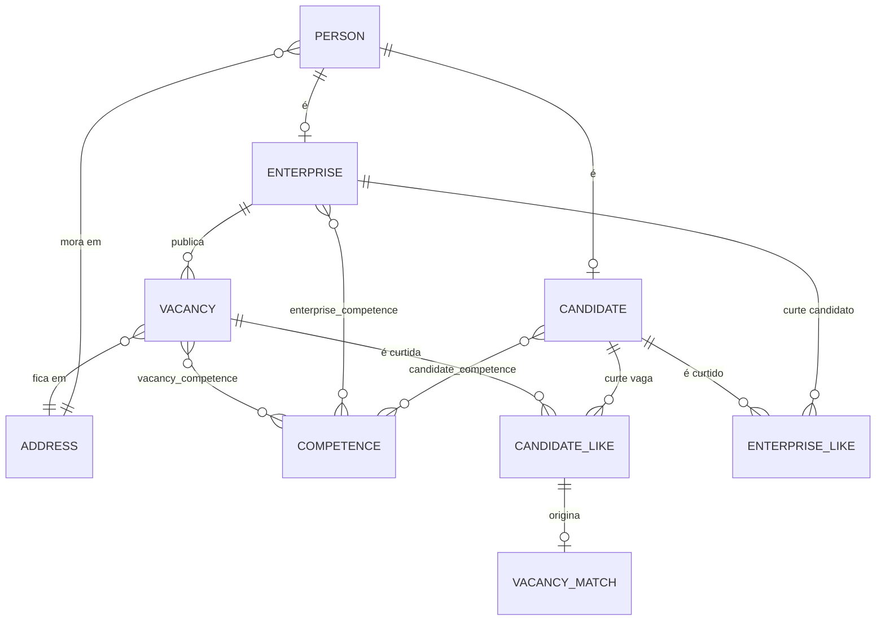

# AGENTS.md — Linketinder

Contexto principal para agentes de IA que trabalham neste repositório. Leia este arquivo inteiro antes de qualquer
mudança. Regras marcadas com 🔒 são invioláveis.

Convenção das fontes:
- `(fonte: caminho/Arquivo#metodo)` indica onde a regra está no código.
- `(fonte: decisão do projeto, 2026-11-23)` indica uma regra definida pelo projeto que ainda não está no código.

---

## 1. Visão geral

O Linketinder é um "LinkedIn + Tinder" para vagas de emprego. Ele conecta **candidatos** e **empresas** pelas
**competências técnicas**, de forma **anônima**:
- o candidato vê as vagas sem saber qual empresa as publicou;
- a empresa vê os candidatos sem dados pessoais.

A identidade só é revelada depois de um **match**. O objetivo é reduzir o viés na contratação (fonte: `README.md`).

---

## 2. Stack

| Camada | Tecnologia | Versão | Fonte |
|---|---|---|---|
| Banco | PostgreSQL + extensão `pgcrypto` | 18.6 | decisão do projeto, 2026-11-23 |
| Back-end | Java (toolchain) | 21 | `Linketinder/build.gradle` |
| Back-end | Gradle (wrapper) | 9.6.0 | `Linketinder/gradle/wrapper/gradle-wrapper.properties` |
| Back-end | Groovy + groovy-json | 4.0.25 | `Linketinder/build.gradle` |
| Back-end | Tomcat embed core (Servlets, sem framework) | 10.1.34 | `Linketinder/build.gradle` |
| Back-end | Driver JDBC PostgreSQL | 42.7.13 | `Linketinder/build.gradle` |
| Testes back-end | Spock / JUnit Platform | 2.3-groovy-4.0 / 5.10.2 | `Linketinder/build.gradle` |
| Front-end | TypeScript | ~6.0.2 | `Frontend/package.json` |
| Front-end | Vite | ^8.3.0 | `Frontend/package.json` |
| Front-end | Bootstrap / Popper | ^5.3.8 / ^2.11.8 | `Frontend/package.json` |
| Front-end | Node.js | 20.19+ ou 22.12+ | `README.md` |
| Testes front-end | — | **nenhum** | `Frontend/package.json` |

---

## 3. Estrutura do repositório

```
Linketinder-Project/
├── AGENTS.md                  # este arquivo
├── README.md                  # visão geral e como executar
├── Database/                  # PostgreSQL
│   ├── schema.sql             # BASE: cria o schema (faz DROP de tudo antes)
│   ├── seed.sql               # BASE: dados de exemplo (inclui curtidas e matches)
│   ├── queries.sql            # consultas de teste (não é produto)
│   ├── migrations/            # (a criar) NNN_descricao.sql, toda mudança de schema (idempotente)
│   ├── linketinder.dbml       # modelo em DBML (atualizado a cada migration)
│   └── DER-Linketinder.png    # diagrama (regenerado manualmente)
├── Linketinder/               # back-end Groovy (Gradle)
│   └── src/
│       ├── main/groovy/com/mariajuliasales/
│       │   ├── Main.groovy          # entrada do menu no terminal
│       │   ├── ApiMain.groovy       # entrada da API REST (Tomcat, porta 8080)
│       │   ├── Application.groovy   # monta as dependências à mão (sem DI)
│       │   ├── api/                 # Servlets + JsonResponse
│       │   ├── controller/          # recebe request DTO e devolve response DTO
│       │   ├── service/             # regras de negócio (CrudService<T>)
│       │   │   └── validator/       # Validator<T> + Validation.require
│       │   ├── repository/          # interfaces de persistência
│       │   ├── dao/                 # implementação JDBC
│       │   ├── model/               # entidades
│       │   ├── dto/request|response # records de entrada e saída
│       │   ├── mapper/              # entidade ↔ DTO
│       │   ├── exception/           # BusinessException e derivadas
│       │   ├── util/                # validadores de CPF, CNPJ, e-mail, senha, CEP
│       │   └── view/                # menus do console (uso administrativo)
│       └── test/groovy/com/mariajuliasales/   # mesma árvore de pacotes + fixture/TestData
├── Frontend/                  # SPA TypeScript + Vite (ISOLADA, ver seção 4.5)
│   └── src/
│       ├── main.ts, router.ts, navigation.ts
│       ├── types.ts           # tipos de domínio e tipos *Anonymous
│       ├── data/              # storage.ts (localStorage) e seed.ts (cópia do seed.sql)
│       ├── services/          # regras do front (auth, candidates, vacancies, matching, stats)
│       ├── pages/             # telas + guards.ts
│       └── ui/                # componentes DOM (badges, hoverCard, barChart, forms…)
└── docs/                      # api.md, backend.md, database.md, frontend.md, refatoracao.md, solid.md
                               # (a criar) specs/<nome-da-feature>/
```

---

## 4. Como executar e testar

### 4.1 Pré-requisitos
- PostgreSQL 18.6 na porta 5432
- JDK 21 (o Gradle vem pelo wrapper)
- Node.js 20.19+ ou 22.12+

### 4.2 Banco de dados (a partir de `Database/`)
```bash
export PGPASSWORD=suasenha
createdb -h localhost -U postgres linketinder                                   # só na primeira vez
psql -h localhost -U postgres -d linketinder -f schema.sql                      # ⚠️ APAGA TODOS OS DADOS
psql -h localhost -U postgres -d linketinder -f seed.sql
for f in migrations/*.sql; do psql -h localhost -U postgres -d linketinder -v ON_ERROR_STOP=1 -f "$f"; done   # idempotentes, podem ser reaplicadas
psql -h localhost -U postgres -d linketinder -P pager=off -f queries.sql        # opcional
```

### 4.3 Back-end (a partir de `Linketinder/`)
```bash
./gradlew build    # compila e roda os testes (não precisa do banco)
./gradlew test     # só os testes
./gradlew run      # menu no terminal (precisa do banco)
./gradlew runApi   # API REST em http://localhost:8080/api (precisa do banco)
```
No Windows, use `gradlew.bat`. Conexão via variáveis de ambiente `DB_TYPE`, `DB_URL`, `DB_USER` e `DB_PASSWORD`.
O padrão é `postgresql`, `jdbc:postgresql://localhost:5432/linketinder`, `postgres`/`postgres`
(fonte: `Linketinder/src/main/groovy/com/mariajuliasales/dao/DatabaseConfig.groovy#fromEnvironment`).

### 4.4 Front-end (a partir de `Frontend/`)
```bash
npm install
npm run dev        # http://localhost:5173
npm run build      # tsc && vite build (é a única checagem automática do front)
```
Contas de teste (senha `123456`): candidato `mariajuliasales@gmail.com` e empresa `contato@techsolutions.com.br`.

### 4.5 Integração entre as camadas

| Camada | Integrada? |
|---|---|
| Banco ↔ Back-end | ✅ JDBC |
| Back-end ↔ Front-end | ❌ **O front está isolado.** Ele não faz chamadas HTTP, guarda tudo no `localStorage` (`Frontend/src/data/storage.ts`) e usa um seed copiado à mão do `seed.sql` (`Frontend/src/data/seed.ts`) |

**Regra:** toda feature nova deve ser implementada nas camadas integradas (banco + back-end) **e também** no front
isolado. Se mudar dados de exemplo no `seed.sql` ou numa migration, replique a mudança em `Frontend/src/data/seed.ts`.
Ao mudar o formato dos dados do front, incremente `DATA_FORMAT_VERSION` em `storage.ts`
(fonte: decisão do projeto, 2026-11-23; `Frontend/src/data/storage.ts#resetStorageIfOutdated`).

API REST existente: só `POST /api/candidates`, `POST /api/enterprises` e `POST /api/vacancies`
(fonte: `Linketinder/src/main/groovy/com/mariajuliasales/ApiMain.groovy#main`). Detalhes em `docs/api.md`.

---

## 5. Banco de dados

### 5.1 Scripts e ordem de aplicação
1. `Database/schema.sql`: base. Começa com `DROP TABLE ... CASCADE`, então **reaplicá-lo apaga todos os dados**.
2. `Database/seed.sql`: base, com os dados de exemplo.
3. `Database/migrations/NNN_descricao.sql`: em ordem numérica crescente (`001_`, `002_`, …), depois do seed. Não há
   tabela de controle: todas as migrations são reaplicadas em ordem a cada execução do laço.
4. `Database/queries.sql`: opcional, só consultas de teste.

O comando exato está na seção 4.2.

### 5.2 Regras de schema (🔒)
- **Toda mudança de schema vira um NOVO script** em `Database/migrations/NNN_descricao.sql`, com o próximo número livre
  e `descricao` em snake_case.
- **Scripts existentes nunca são editados:** `schema.sql`, `seed.sql`, `queries.sql` e migrations já criadas.
- **Toda migration é idempotente:** rodar duas vezes produz o mesmo estado, sem erro. Use `CREATE ... IF NOT EXISTS`,
  `ADD COLUMN IF NOT EXISTS`, `DROP ... IF EXISTS`, `INSERT ... ON CONFLICT DO NOTHING` e, quando não houver forma
  nativa (ex.: `ADD CONSTRAINT`, `CREATE TYPE`), um bloco `DO $$ ... $$` que verifica `pg_catalog`/`information_schema`
  antes de agir.
- Uma migration deve rodar sem erro depois de `schema.sql` + `seed.sql` + as migrations anteriores, **e** ao ser
  reaplicada sobre um banco que já a recebeu.
- **Toda migration atualiza o `Database/linketinder.dbml`** na mesma mudança.
- O `Database/DER-Linketinder.png` é **regenerado manualmente pela desenvolvedora**. O agente não gera a imagem; ele
  marca o item no checklist da feature (seção 11).

(fonte: decisão do projeto, 2026-11-23)

### 5.3 Garantias que já existem no banco (fonte: `Database/schema.sql`)

| Regra | Como |
|---|---|
| Uma pessoa é candidato **ou** empresa | FK composta `(person_id, person_type)` → `person(id, type)` + `CHECK` |
| E-mail, CPF, CNPJ e nome da competência são únicos | `UNIQUE` |
| Uma curtida por candidato/vaga e por empresa/candidato | PK composta |
| Não existe match sem `candidate_like` | FK `vacancy_match_like_fkey` com `ON DELETE CASCADE` |
| Senha nunca em texto | `crypt(?, gen_salt('bf'))` (fonte: `dao/PersonDAO.groovy#INSERT_PERSON`) |
| Excluir pessoa/empresa apaga vagas, curtidas e matches | `ON DELETE CASCADE` |
| Endereço e competência em uso não podem ser apagados | `ON DELETE RESTRICT` |
| Endereço é compartilhável; alterar cria um novo | `COMMENT ON TABLE address`; `PersonDAO#updatePerson`, `VacancyDAO#update` |

---

## 6. Domínio

| Entidade | Tabela(s) | Atributos principais | Back-end | Front |
|---|---|---|---|---|
| Pessoa (base) | `person` | `id`, `type`, `name`, `email`, `description`, `password_hash`, `address_id`, `created_at` | `model/Person`, `AbstractPerson` | `Person` |
| Candidato | `candidate` | `cpf`, `birth_date`, `training` (+ dados de `person`) | `model/Candidate` (`getAge` calculado) | `Candidate` |
| Empresa | `enterprise` | `cnpj` (+ dados de `person`) | `model/Enterprise` (`vacancies`) | `Enterprise` |
| Vaga | `vacancy` | `title`, `description`, `status` (`OPEN`/`PAUSED`/`CLOSED`, padrão `OPEN`), `address_id`, `enterprise_id` | `model/Vacancy` | `Vacancy` |
| Competência | `competence` + 3 tabelas N:N | `name` (único, até 50 caracteres) | `model/Competence` (igualdade sem diferenciar maiúsculas) | union fixa `COMPETENCES` |
| Endereço | `address` | `cep`, `street`, `number`, `complement`, `neighborhood`, `city`, `state`, `country` | `model/Address` | `Address` (cep, cidade, UF, país) |
| Curtida | `candidate_like`, `enterprise_like` | `candidate_id` + `vacancy_id` / `enterprise_id` + `candidate_id`, `created_at` | **não existe** | **não existe** |
| Match | `vacancy_match` | `candidate_id`, `vacancy_id`, `matched_at` | **não existe** | **não existe** |

### 6.1 Relacionamentos



- `person` 1:1 `candidate` **ou** `enterprise`.
- `enterprise` 1:N `vacancy`.
- `candidate`, `enterprise` e `vacancy` N:N `competence`.
- `candidate` N:N `vacancy` via `candidate_like`.
- `enterprise` N:N `candidate` via `enterprise_like`.
- `vacancy_match` é 0..1 por `candidate_like`, e único por (candidato, vaga).

(fonte: `Database/schema.sql`, `Database/linketinder.dbml`)

---

## 7. Regras de negócio centrais

> **Estado atual:** curtida e match **existem só no banco** (tabelas, seed e `queries.sql`). Não há código no back-end
> (model, service, DAO, API) nem no front-end. A home do front mostra "Dê match – em breve"
> (fonte: `Frontend/src/pages/home.ts#STEPS`).

### 7.1 Quem curte quem
- **Candidato → vaga:** o candidato curte uma vaga (fonte: `Database/schema.sql#candidate_like`).
  - Só pode curtir vagas com status `OPEN`. O serviço valida isso.
  - Curtidas existentes continuam valendo se a vaga for pausada (`PAUSED`) ou fechada (`CLOSED`).
- **Empresa → candidato:** a empresa curte um candidato, não uma vaga (fonte: `Database/schema.sql#enterprise_like`).
  - Pode curtir **qualquer** candidato, mesmo que ele não tenha curtido nenhuma vaga dela.
- Uma curtida por par (PK composta).

(fonte: decisão do projeto, 2026-11-23)

### 7.2 Quando o match acontece
- Só existe match para (candidato C, vaga V) quando há **as duas** curtidas: `candidate_like(C, V)` **e**
  `enterprise_like(E, C)`, sendo E a empresa dona de V. A ordem não importa
  (fonte: `docs/database.md#Lógica do match`; `Database/seed.sql`, `INSERT INTO vacancy_match`).
- **A camada de serviço cria o match**, na mesma transação da curtida que completa o par
  (fonte: decisão do projeto, 2026-11-23).
- O banco garante só o `candidate_like` (FK). **Ele não garante o `enterprise_like`.** O serviço precisa verificar
  essa curtida e ter testes que cubram isso.
- Uma curtida da empresa num candidato completa o match com **todas** as vagas dessa empresa que o candidato curtiu.
- **O match só existe enquanto as duas curtidas existirem.** Remover qualquer uma delas remove o match:
  - remover o `candidate_like(C, V)` apaga o match em cascata, pelo banco
    (fonte: `Database/schema.sql#vacancy_match_like_fkey`);
  - remover o `enterprise_like(E, C)` **não** dispara nada no banco. O serviço apaga, na mesma transação, os matches
    de C com **todas** as vagas de E (fonte: decisão do projeto, 2026-11-23).

### 7.3 O que muda depois do match
- Para o par (candidato, vaga) com match, passam a ser visíveis: **nome e e-mail dos dois lados** e o **nome da empresa
  dona da vaga** (fonte: decisão do projeto, 2026-11-23).
- Os outros dados seguem a tabela da seção 8.

### 7.4 Validações existentes

| Regra | Fonte |
|---|---|
| Nome obrigatório, e-mail válido, endereço com CEP válido e cidade/UF | `service/validator/PersonValidator.groovy#validateCommonFields` |
| Senha com 6+ caracteres; obrigatória no cadastro e opcional na atualização | `PersonValidator#validatePassword`, `util/PasswordValidator.groovy#isValid` |
| CPF válido, data de nascimento e formação obrigatórias | `service/validator/CandidateValidator.groovy#validateCandidateFields` |
| CNPJ válido | `service/validator/EnterpriseValidator.groovy#validateEnterpriseFields` |
| Vaga com título, descrição, empresa, cidade/UF e pelo menos 1 competência | `service/validator/VacancyValidator.groovy#validate` |
| Status vazio vira `OPEN`; valor inválido gera erro | `mapper/VacancyMapper.groovy#toStatus` |
| Competência sem repetição (sem diferenciar maiúsculas) | `service/CompetenceService.groovy#checkBusinessRules` |
| Candidato vê só vagas `OPEN` (front) | `Frontend/src/services/vacancies.ts#listOpenVacancies` |
| Empresa só exclui as próprias vagas (front) | `Frontend/src/services/vacancies.ts#deleteOwnVacancy` |

---

## 8. 🔒 Princípio do Anonimato (RESTRIÇÃO INVIOLÁVEL)

> **Nenhuma feature, endpoint, consulta, DTO, log ou tela pode expor dados identificáveis antes do match.
> Em caso de dúvida, o dado NÃO é exibido.**

(fonte: decisão do projeto, 2026-11-23; `README.md`; `docs/database.md`)

### 8.1 Candidato (visto pela empresa)

| Dado | Antes do match | Depois do match |
|---|---|---|
| Formação (`training`) | ✅ | ✅ |
| Descrição | ✅ | ✅ |
| Competências | ✅ | ✅ |
| Nome | ❌ | ✅ |
| E-mail | ❌ | ✅ |
| CPF | ❌ | ❌ nunca |
| Data de nascimento | ❌ | ❌ nunca |
| Idade (calculada por `Candidate#getAge`) | ❌ | ❌ nunca |
| Endereço completo (rua, número, CEP…) | ❌ | ❌ nunca |
| Senha / hash | ❌ | ❌ nunca |
| `id` interno | só na API, nunca na tela como identificador | só na API |

### 8.2 Empresa e vaga (vistas pelo candidato)

O candidato **não vê perfil de empresa**, nem anônimo. Ele vê só **vagas anônimas**.

| Dado | Antes do match | Depois do match |
|---|---|---|
| Título da vaga | ✅ | ✅ |
| Descrição da vaga | ✅ | ✅ |
| Cidade/UF da vaga | ✅ | ✅ |
| Status da vaga | ✅ | ✅ |
| Competências da vaga | ✅ | ✅ |
| Qualquer vínculo vaga → empresa (`enterpriseId`, nome, e-mail, CNPJ) | ❌ | só nome e e-mail |
| Nome da empresa | ❌ | ✅ |
| E-mail da empresa | ❌ | ✅ |
| Perfil da empresa (descrição, competências, UF, país, nº de vagas) | ❌ | ❌ |
| CNPJ | ❌ | ❌ nunca |
| Endereço completo da empresa | ❌ | ❌ nunca |
| Senha / hash | ❌ | ❌ nunca |
| `id` interno | só na API, nunca na tela como identificador | só na API |

### 8.3 Nunca exibidos a outro usuário (nem depois do match)
Senha (e hash), CPF, CNPJ, data de nascimento, idade calculada e endereço completo.

(fonte: decisão do projeto, 2026-11-23)

### 8.4 Regras de implementação
- Listagens e respostas para terceiros usam **sempre** DTOs `*AnonymousResponse`, montados **campo a campo** no mapper
  (fonte: `mapper/CandidateMapper.groovy#toAnonymousResponse`, `mapper/VacancyMapper.groovy#toAnonymousResponse`).
- **O `EnterpriseAnonymousResponse` nunca é exposto a candidatos**, nem em rota da API, nem no front. Ele só é usado no
  console administrativo (seção 12). Para o candidato, use `VacancyAnonymousResponse`
  (fonte: decisão do projeto, 2026-11-23).
- **Nunca serialize entidades.** Exemplo crítico: `VacancyDAO` faz JOIN com `person` e preenche `Vacancy.enterprise` com
  nome, e-mail e CNPJ (fonte: `dao/VacancyDAO.groovy#SELECT_VACANCY`, `#enterpriseOf`).
- No front, a mesma regra vale com os tipos `CandidateAnonymous` e `VacancyAnonymous`, montados por desestruturação
  (fonte: `Frontend/src/services/candidates.ts#listAnonymousCandidates`, `services/vacancies.ts#toAnonymousVacancy`).
  Na tela, o candidato aparece como "Candidato #N", pela posição na lista (fonte: `pages/candidates.ts#candidateLabel`).
- **Respostas de cadastro** podem devolver os dados do próprio usuário, **nunca a senha**
  (fonte: decisão do projeto, 2026-11-23; `CandidateMapper#toResponse`, `EnterpriseMapper#toResponse`).
- Um DTO novo para terceiros precisa de teste no `*MapperSpec` que confirme a ausência dos campos proibidos.

### 8.5 Onde o anonimato costuma vazar (checar sempre)

| Lugar | O que verificar |
|---|---|
| Consultas SQL com JOIN | JOIN com `person`/`enterprise` traz nome, e-mail, CNPJ e CPF para a memória. Selecione só as colunas necessárias |
| Serialização de objetos inteiros | `JsonResponse.send` serializa qualquer objeto. Passe só DTOs anônimos, nunca entidades nem `Map` montado a partir delas |
| `toString` / logs | `printStackTrace` em `JsonResponse#sendError`; `AbstractPerson.password` em memória; nada de `println` de entidades |
| Respostas da API | Toda rota de listagem ou leitura para terceiros devolve `*AnonymousResponse` |
| Front-end | `pages/` deve receber só os tipos `*Anonymous`. Atenção aos hover cards (`ui/hoverCard.ts`) e aos atributos `aria-*`/`data-*` |
| Mensagens de erro | Não confirme a existência de e-mail, CPF ou CNPJ de terceiros além do que já existe (409 no cadastro) |

---

## 9. Convenções de código

### 9.1 Back-end (Groovy)
- Pacote raiz `com.mariajuliasales`, organizado por camada (seção 3). Indentação com **tab**.
- Nomes de código em **inglês**; mensagens ao usuário em **português**.
- Fluxo: `view`/`api` → `controller` → `service` → `repository` (interface) → `dao` (JDBC).
- **Controller** recebe `*Request` e devolve `*Response`, nunca entidades. `findAll` → anônimo; `findById` → completo
  (fonte: `controller/CandidateController.groovy`).
- **Service** estende `CrudService<T>`: valida (`validateForCreate`/`validateForUpdate`), depois chama
  `checkBusinessRules`, depois o repositório. Regras específicas ficam em `checkBusinessRules`
  (fonte: `service/CrudService.groovy`, `service/CompetenceService.groovy#checkBusinessRules`).
- **Validator** implementa `Validator<T>` e usa `Validation.require(cond, msg)` (fonte: `service/validator/Validation.groovy#require`).
- **Repository** é interface; **DAO** implementa. Pessoas usam o template `PersonDAO<T>`. SQL em constantes
  `private static final String`, sempre com `?` (nunca concatene valores). Use `SqlExecutor`, `withConnection` e
  `withTransaction` (fonte: `dao/PersonDAO.groovy`, `dao/SqlExecutor.groovy`).
- **DTOs** são `record`. **Mappers** são `final class` com métodos `static` e tratam `null`.
- **Utilitários** são `final class` com métodos `static`.
- As dependências são montadas à mão em `Application.groovy#createControllers`. Registre ali todo componente novo.

### 9.2 Exceções

| Exceção (todas derivam de `BusinessException`) | Quando | HTTP |
|---|---|---|
| `ValidationException` | dado inválido (`Validation.require`) | 400 |
| `EntityNotFoundException` | `requireFound` / id inexistente | 404 |
| `DuplicateEntityException` | `UNIQUE` violada (traduzida pelo `SqlExceptionTranslator`) | 409 |
| `EntityInUseException` | FK/RESTRICT violada | 500 (ver seção 12) |
| `JsonException`, `DateTimeParseException` | JSON malformado | 400 |

(fonte: `api/JsonResponse.groovy#sendError`, `dao/SqlExceptionTranslator.groovy#translate`)

Erros de SQL novos devem ser traduzidos no `SqlExceptionTranslator`, sem `catch` espalhado pelos DAOs.

### 9.3 Testes (back-end)
- Spock, em `Linketinder/src/test/groovy/com/mariajuliasales/<pacote>/<Classe>Spec.groovy`, espelhando `main`.
- Nome do teste em inglês, como frase: `def "create should save a valid candidate"()`.
- Blocos `given`/`when`/`then`/`expect`. Use `Mock()` para repositórios (e para verificar com `0 *` que nada foi salvo
  em caso de erro) e `Stub()` para `HttpServletRequest`.
- Dados de teste vêm de `fixture/TestData.groovy` (`validCandidate(changes)`, `validEnterprise`, `validVacancy`).
- Os testes não usam o banco: `./gradlew test` precisa passar sem PostgreSQL.

### 9.4 Front-end (TypeScript)
- Indentação de 2 espaços, aspas simples, `strict: true`, sem variáveis ou parâmetros não usados (`tsconfig.json`).
- `types.ts` concentra os tipos. `services/` tem a lógica sem DOM. `pages/` monta as telas. `ui/` tem os componentes.
- O DOM é criado com `createElement`/`elementFromTemplate` (`ui/dom.ts`). Use `innerHTML` só com conteúdo fixo,
  nunca com dados do usuário.
- Telas protegidas usam `requireLoggedCandidate`/`requireLoggedEnterprise` (`pages/guards.ts`).

---

## 10. Restrições para agentes

1. 🔒 **Não quebre o Princípio do Anonimato** (seção 8). Na dúvida, não exiba e pergunte.
2. 🔒 **Não altere scripts SQL existentes.** Toda mudança de schema vira uma nova migration em `Database/migrations/`.
3. **Toda regra nova precisa de testes.** No back-end, com Spock. No front, ver ⚠️ na seção 13.
4. **Não adicione dependências sem justificar** (motivo, alternativa sem a dependência, versão exata) na spec ou no PR.
5. **Faça mudanças pequenas e revisáveis:** uma preocupação por mudança, sem refatorar código não relacionado.
6. Implemente features no banco + back-end **e** no front isolado (seção 4.5).
7. Não estenda os menus do console com dados identificáveis (seção 12).
8. A feature **Recrutador** está fora do escopo deste arquivo e terá spec própria. Não deduza regras dela daqui.
9. `./gradlew build` e `npm run build` devem passar ao fim de cada tarefa.

---

## 11. Fluxo de trabalho com IA

- Features novas seguem a skill `skills/feature-com-spec/SKILL.md`.
- As specs ficam em `docs/specs/<nome-da-feature>/`.
- Toda tarefa atualiza o `CHANGELOG.md`, no padrão [Keep a Changelog](https://keepachangelog.com/pt-BR/1.1.0/), na seção
  `[Não lançado]` (`Adicionado`, `Modificado`, `Corrigido`, `Removido`…).
- Checklist mínimo de toda feature (deve constar na spec):
  - [ ] testes cobrindo as regras novas (seção 10);
  - [ ] anonimato conferido nos pontos da seção 8.5;
  - [ ] se houver mudança de schema: nova migration idempotente em `Database/migrations/`;
  - [ ] se houver mudança de schema: `Database/linketinder.dbml` atualizado;
  - [ ] se houver mudança de schema: `Database/DER-Linketinder.png` regenerado **manualmente pela desenvolvedora**.
    O agente deixa este item aberto e o sinaliza;
  - [ ] seed do front (`Frontend/src/data/seed.ts`) alinhado, se os dados de exemplo mudaram;
  - [ ] `CHANGELOG.md` atualizado em `[Não lançado]`.
- A skill, a pasta `docs/specs/` e o `CHANGELOG.md` **ainda não existem** e serão criados nas próximas etapas. Se não estiverem no repositório,
  pergunte antes de inventar o formato.

---

## 12. Limitações e violações conhecidas

Problemas que já existem no código. Não os copie em código novo. Corrija-os só numa tarefa própria.

| Item | Situação | Fonte |
|---|---|---|
| Menus do console | Uso **administrativo**, sem login: "Ver perfil completo" e "Ver dados completos" mostram CPF, CNPJ, idade, e-mail e endereço; as listagens exibem o `id`; "Listar empresas" usa o `EnterpriseAnonymousResponse` (perfil de empresa, que candidatos não podem ver). **Não estenda.** | `view/CandidateMenu.groovy#showCandidate`, `view/EnterpriseMenu.groovy#showEnterprise`, `view/ResponseFormatter.groovy` |
| Senha em texto puro no front | Gravada no `localStorage` e comparada em texto no login | `Frontend/src/services/auth.ts#login`, `Frontend/src/types.ts#Person` |
| Descrição livre | Pode identificar a pessoa ou empresa (ex.: seed "Pastelsoft… restaurantes") | `Database/seed.sql` |
| Endereço da vaga | A vaga pode usar o endereço da sede, o que revela a cidade da empresa | `Database/seed.sql` (`CASE WHEN data.city IS NULL THEN p.address_id`) |
| Idade mínima de 16 anos | Validada só no front; o back-end não valida | `docs/frontend.md`; ausente em `CandidateValidator` |
| `EntityInUseException` | Não está mapeada e cai no 500 | `api/JsonResponse.groovy#sendError` |
| Front sem testes | Não há ferramenta nem script `test` | `Frontend/package.json` |
| Sem testes de integração com o banco | Todos os testes usam mocks; SQL e constraints não são testados automaticamente | `Linketinder/src/test/` |
| `Vacancy.enterprise` com dados identificáveis | Carregado pelo DAO; vazaria se a entidade fosse serializada | `dao/VacancyDAO.groovy#enterpriseOf` |
| Stack trace no log | Erros 500 chamam `printStackTrace` | `api/JsonResponse.groovy#sendError` |
| Front isolado | Não conversa com a API; seed duplicado | `Frontend/src/data/storage.ts`, `Frontend/src/data/seed.ts` |
| Curtida e match | Existem só no banco | seção 7 |

---

## 13. ⚠️ Pontos a confirmar

- ⚠️ A CONFIRMAR: **testes de regras no front.** A regra "toda regra nova precisa de testes" exige uma ferramenta
  (ex.: Vitest), o que seria uma dependência nova a justificar.
