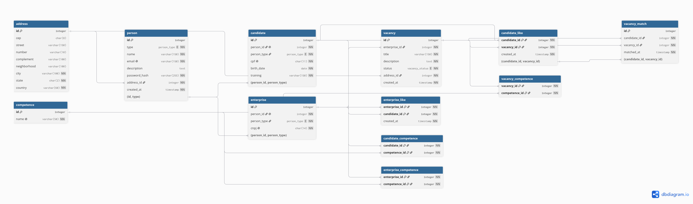

# Banco de dados 


Modelagem e SQL do banco do Linketinder. O banco tem dados de exemplo e consultas de teste, e é usado pelo
backend por meio de JDBC (veja [Integração com o banco](backend.md#integração-com-o-banco-jdbc)).


## Tecnologias

* **Banco:** PostgreSQL
* **Modelagem:** DBML, com o diagrama gerado no [dbdiagram.io](https://dbdiagram.io)
* **Senhas:** extensão `pgcrypto` (hash bcrypt)

## DER



O modelo completo está em [`Database/linketinder.dbml`](../Database/linketinder.dbml).

## Lógica do match

1. O candidato vê as vagas sem os dados da empresa e curte uma vaga (`candidate_like`).
2. A empresa vê os candidatos sem nome nem dados pessoais e curte um candidato (`enterprise_like`).
3. Há match quando o candidato curtiu a vaga e a empresa dona dessa vaga curtiu o candidato.
   A ordem das curtidas não importa. O match é gravado em `vacancy_match`.
4. Se o candidato remover a curtida, o match é apagado junto.
5. Só depois do match os dados de identificação (nome, e-mail) são mostrados para o outro lado.

## Regras do banco

| Regra | Como |
|-------|------|
| Uma pessoa é candidato ou empresa | FK composta `(person_id, person_type)` → `person(id, type)` |
| E-mail, CPF, CNPJ e nome da competência não se repetem | `UNIQUE` |
| Uma curtida por candidato/vaga e por empresa/candidato | Chave primária composta |
| Não existe match sem a curtida do candidato | FK de `vacancy_match` para `candidate_like` |
| Excluir uma pessoa apaga em cascata o candidato/empresa, as vagas, as curtidas e os matches | `ON DELETE CASCADE` |
| Endereço e competência em uso não podem ser apagados | `ON DELETE RESTRICT` |
| A senha nunca é gravada em texto | Hash bcrypt com `crypt()` |

## Dados de exemplo

O `seed.sql` cria 6 candidatos, 6 empresas, 8 vagas (uma encerrada), curtidas e matches. Todas as contas usam a
senha `123456`, gerada uma vez pela função temporária `pg_temp.seed_password_hash()`. Os mesmos dados são usados
como exemplo no frontend.

## Estrutura de pastas

```text
Database/
├── linketinder.dbml       # modelo do banco (DER)
├── DER-Linketinder.png    
├── schema.sql             # criação das tabelas, constraints e índices
├── seed.sql               # dados de exemplo
└── queries.sql            # consultas que testam as relações, as curtidas e o match
```

Para rodar as consultas de teste depois de criar e popular o banco:

```bash
psql -h localhost -U postgres -d linketinder -P pager=off -f Database/queries.sql
```
