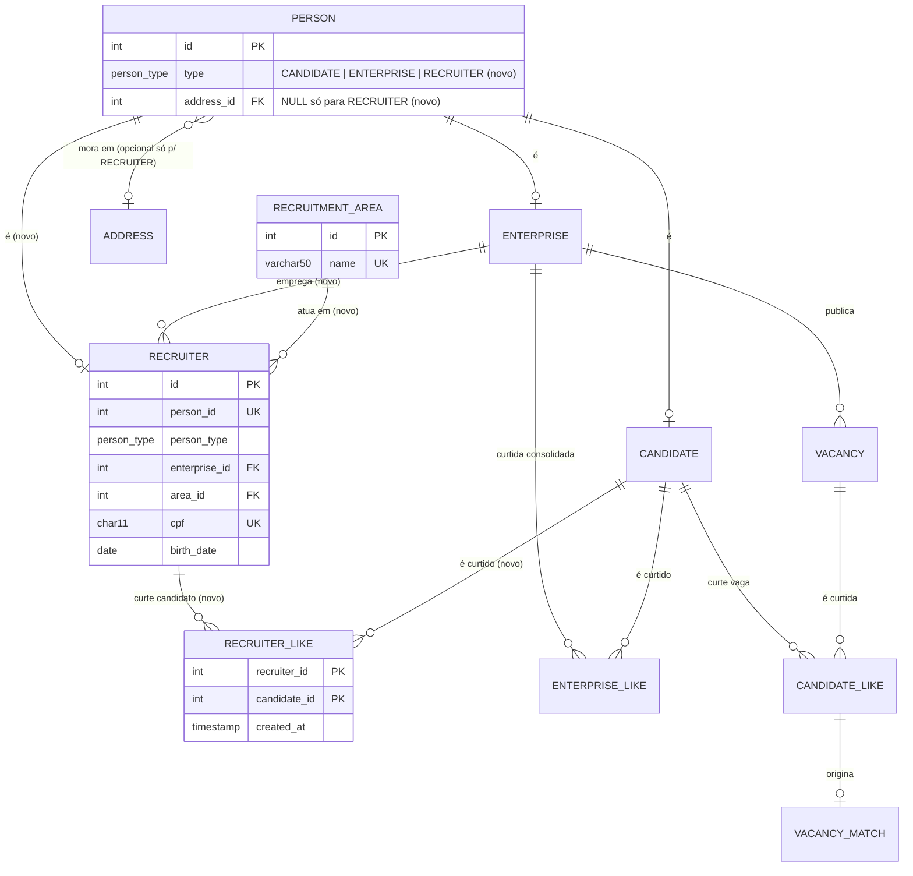

# Spec: Recrutador

- **Branch:** `feat/recruiter`
- **Issue:** [#21](https://github.com/mariajuliasales/Linketinder-Project/issues/21)
- **Status:** aprovada
- **Referência do projeto:** [AGENTS.md](../../../AGENTS.md)

---

## 1. Contexto e objetivo

### Contexto

Hoje a empresa é o único usuário que analisa candidatos. Na prática, esse trabalho é feito por pessoas da empresa: os
**recrutadores**. A issue #21 define o recrutador como um colaborador da empresa (N recrutadores : 1 empresa) com nome,
área de recrutamento, descrição, e-mail, CPF, data de nascimento e senha.

Estado atual do código que a feature toca:

- **Curtida e match existem só no banco** (`candidate_like`, `enterprise_like`, `vacancy_match`, seed e `queries.sql`).
  Não há código no back-end nem no front (AGENTS.md › Regras de negócio centrais). Sem curtida do candidato não existe
  match, então esta feature implementa o fluxo completo de curtida e match.
- `enterprise_like` tem PK `(enterprise_id, candidate_id)`: guarda **uma** curtida por empresa e candidato, sem dizer
  quem curtiu.
- `person.type` é o ENUM `person_type` (`CANDIDATE`, `ENTERPRISE`), e `candidate`/`enterprise` usam FK composta
  `(person_id, person_type)` + `CHECK`. A coluna `person.address_id` é `NOT NULL`.
- `PersonDAO` sempre grava endereço e competências, e `PersonValidator` exige CEP. O recrutador não tem nenhum dos dois.
- O back-end não tem login nem sessão. A API confia no `enterpriseId` enviado no corpo (`api/VacancyServlet`).
- O front está isolado (`localStorage`) e guarda a senha em texto (AGENTS.md › Limitações e violações conhecidas).

### Objetivo

1. Criar o recrutador como novo tipo de pessoa, vinculado a uma única empresa, cadastrado e removido só por ela.
2. Implementar a curtida do candidato em vagas e a curtida do recrutador em candidatos.
3. Manter a curtida da empresa (`enterprise_like`) como a **curtida consolidada** dos recrutadores dela, para que a regra
   de match da seção 7.2 do AGENTS.md continue igual.
4. Criar e remover matches na camada de serviço, na mesma transação da curtida.
5. Revelar os dados permitidos depois do match, sem quebrar o Princípio do Anonimato.
6. Entregar tudo no banco + back-end **e** no front isolado (AGENTS.md › Integração entre as camadas).

### Como será feito

- **Banco:** migrations novas em `Database/migrations/` (seção 3.3), sem editar scripts existentes, e
  `Database/linketinder.dbml` atualizado.
- **Back-end:** segue AGENTS.md › Convenções de código. O recrutador tem model, repository, DAO, validator, service,
  DTOs, mapper, controller e servlet próprios.
  - `RecruiterDAO` **não** estende o `PersonDAO` como ele está, porque o template grava endereço e competências. O
    plano decide como reaproveitar a parte de `person`.
  - Curtidas e matches ficam em services próprios.
  - **A lógica de decisão fica no serviço.** O serviço decide quando criar ou apagar o `enterprise_like` e os matches,
    chamando métodos pequenos do repositório dentro de **uma transação aberta pelo serviço**. Com isso, os casos de
    borda podem ser testados com Spock e `Mock()`, sem banco (AGENTS.md › Testes). O plano define a abstração de
    transação.
- **Front:**
  - `RECRUITER` em `PersonType`;
  - coleções novas no `storage.ts` e `DATA_FORMAT_VERSION` = `5`;
  - guard `requireLoggedRecruiter`;
  - telas novas;
  - seed alinhado às migrations.
- **Sem dependências novas.**

---

## 2. Regras de negócio

### 2.1 Recrutador (cadastro e remoção)

**Comportamentos esperados**

- **Vínculo**
  - Todo recrutador pertence a **exatamente uma** empresa (`recruiter.enterprise_id NOT NULL`, N:1).
  - O vínculo é fixo: para trocar de empresa, é preciso remover e cadastrar de novo.
- **Cadastro**
  - **Só a empresa** cadastra os próprios recrutadores. Não existe auto-cadastro de recrutador: a tela de cadastro
    público continua só com candidato e empresa.
  - Campos: nome, e-mail, senha inicial, descrição, CPF, data de nascimento e área.
  - O recrutador **não tem endereço nem competências**.
- **Remoção**
  - **Só a empresa** remove os próprios recrutadores.
  - O recrutador não exclui a própria conta.
- **Edição**
  - O recrutador pode editar a própria descrição e a própria senha.
  - A senha é opcional na atualização. Se vier preenchida, é validada.
  - Recrutador inexistente → 404, com a mesma mensagem da remoção.
  - A edição existe no **service** (`RecruiterService`, com teste Spock) e no **front** (tela do próprio recrutador).
    **Não há rota na API**: o `POST /api/recruiters` é a única rota nova (seção 7).
- **Validações** (400 `ValidationException`, salvo indicação):
  - **Nome:** obrigatório.
  - **E-mail:**
    - formato válido (`EmailValidator`);
    - único entre **todas** as pessoas, sem diferenciar maiúsculas e minúsculas;
    - o serviço checa com `lower()` antes de salvar;
    - se já existir, responde 409 `DuplicateEntityException` "E-mail já cadastrado".

    Isso permite que a empresa descubra se um e-mail pertence a um candidato. É uma limitação aceita (decisão do
    projeto): e-mail único só entre recrutadores quebraria o login por e-mail (4.6, 6.6).
  - **Senha:** 6 ou mais caracteres (`PasswordValidator`). Obrigatória no cadastro.
  - **CPF:**
    - válido (`CpfValidator`);
    - único **entre recrutadores** (`UNIQUE`, constraint `recruiter_cpf_key`, traduzida no `SqlExceptionTranslator`
      para 409 "CPF já cadastrado");
    - **pode ser igual ao CPF de um candidato**, porque a pessoa pode procurar emprego em outra empresa (ver 2.3).
      Decisão do projeto.
  - **Data de nascimento:**
    - obrigatória;
    - não pode estar no futuro;
    - idade mínima de **18 anos**, validada no back-end.
  - **Área:**
    - obrigatória;
    - precisa existir na lista fixa `recruitment_area` (TI, RH, Marketing, Segurança da Informação, Financeiro,
      Comercial, Operações);
    - se não existir, responde "Área de recrutamento inválida".
  - **Descrição:** opcional.
- **Efeito da remoção** (serviço, **uma transação**):
  1. apaga as `recruiter_like` do recrutador;
  2. para cada candidato C que ele curtia, se **nenhum outro** recrutador da mesma empresa E ainda curte C, apaga o
     `enterprise_like(E, C)` e os `vacancy_match` de C com **todas** as vagas de E (AGENTS.md › Quando o match acontece);
  3. apaga o recrutador (`recruiter` e `person`).
- **Exclusão da empresa:** apaga os recrutadores dela (`ON DELETE CASCADE`), junto com as vagas, as curtidas e os
  matches, como já acontece hoje.

**Casos de borda**

- **Empresa tenta remover recrutador de outra empresa** → 404 "Recrutador com ID `<id>` não existe" (mesma mensagem de
  um id inexistente). A resposta não confirma que o recrutador existe.
- **Recrutador com id inexistente** → 404.
- **E-mail igual ao de um candidato, empresa ou recrutador, mesmo com maiúsculas diferentes** (`Ana@X.com` × `ana@x.com`)
  → 409 "E-mail já cadastrado".
- **CPF igual ao de outro recrutador**, com ou sem máscara → 409 "CPF já cadastrado".
- **CPF igual ao de um candidato** → cadastro aceito (decisão do projeto).
- **Idade:**
  - recrutador que faz 18 anos hoje → aceito;
  - recrutador que faz 18 anos amanhã → 400.
- **Área:**
  - com maiúsculas diferentes (`ti`) → aceita como `TI`;
  - fora da lista (`Jurídico`) → 400.
- **Empresa inexistente no cadastro** (`enterpriseId` inválido na API) → 404 "Empresa com ID `<id>` não existe".
- **Remoção de um recrutador que é o único a curtir C, enquanto outro recrutador curte D** → somem só o
  `enterprise_like(E, C)` e os matches de C. Os de D continuam.

Os 404 usam o formato padrão do projeto, "`<Entidade>` com ID `<id>` não existe" (`EntityNotFoundException`).

**Bug conhecido: e-mail único diferencia maiúsculas**

- O `UNIQUE` de `person.email` diferencia maiúsculas, mas o `PersonDAO#findByEmail` busca com `lower()`. O banco aceita
  `A@x.com` e `a@x.com` em pessoas diferentes.
- Nesta feature, o serviço do recrutador checa o e-mail com `lower()` contra **todas** as pessoas. Cadastro de candidato
  e de empresa continua como está.
- O índice `UNIQUE (lower(email))` e a correção para candidato e empresa estão fora do escopo (seção 7).

### 2.2 Curtida do candidato

**Comportamentos esperados**

- **Curtir:**
  - o candidato C curte a vaga V (`candidate_like(C, V)`);
  - só é permitido se V estiver `OPEN`. Caso contrário → 400 "Só é possível curtir vagas abertas";
  - se já existe `enterprise_like(E, C)`, sendo E a dona de V, o serviço cria o `vacancy_match(C, V)` **na mesma
    transação**.
- **Status depois da curtida:** curtidas e matches existentes continuam valendo se a vaga for pausada ou fechada
  (AGENTS.md › Quem curte quem).
- **Descurtir:**
  - o candidato pode remover a curtida em qualquer status da vaga;
  - o match `(C, V)` é apagado em cascata pelo banco (`vacancy_match_like_fkey`). No front, o serviço apaga o match.
- **Minhas curtidas:**
  - a tela de vagas do candidato ganha a seção "Minhas curtidas", com as vagas que **ele** curtiu, em **qualquer**
    status (`OPEN`, `PAUSED`, `CLOSED`);
  - cada vaga mostra os dados anônimos (título, descrição, cidade/UF, competências), o **status** e o botão de
    descurtir;
  - dados da empresa: só o que a seção 2.4 e a tabela 4.2 já liberam, ou seja, nome e e-mail da empresa **só na vaga
    com match**. Sem match, nenhum dado da empresa;
  - a lista principal da tela continua só com as vagas `OPEN` (AGENTS.md › Validações existentes);
  - no back-end, o controller de curtidas oferece a mesma lista (sem rota na API, seção 6.4), com o DTO de vaga com
    match da tabela 4.2.

**Casos de borda**

- **Minhas curtidas:**
  - vaga curtida e depois pausada ou fechada → sai da lista principal, continua em "Minhas curtidas" com o novo status
    e pode ser descurtida;
  - candidato sem curtidas → a seção mostra uma mensagem de lista vazia;
  - C tem match com V1 de E e curtiu V2 de E sem match → nome e e-mail da empresa só em V1 (2.4).
- **Vaga:**
  - curtir vaga `PAUSED` ou `CLOSED` → 400. Nada é salvo e nenhum match é criado;
  - curtir vaga inexistente → 404 "Vaga com ID `<id>` não existe".
- **Curtidas repetidas ou inexistentes:**
  - curtir de novo a mesma vaga → nada muda e não há erro (idempotente);
  - descurtir uma vaga não curtida → nada muda e não há erro.
- **Match:**
  - curtir uma vaga de E quando E ainda não curtiu C (nenhum recrutador de E curte C) → só a curtida é salva, sem match;
  - curtir uma vaga de E quando E já curte C → curtida + match na mesma transação. Se a gravação do match falhar, a
    curtida também é desfeita.

### 2.3 Curtida do recrutador e match

**Comportamentos esperados**

- **A empresa deixa de curtir diretamente.** Depois desta feature, só recrutadores curtem candidatos. A conta da empresa
  continua vendo a lista anônima de candidatos, sem botão de curtir.
- **Curtir:** o recrutador R, da empresa E, curte o candidato C (`recruiter_like(R, C)`). Ele pode curtir **qualquer**
  candidato, mesmo um que não curtiu nenhuma vaga de E (AGENTS.md › Quem curte quem). A área de R não limita nada.
- **Invariante:**

  > `enterprise_like(E, C)` existe **se e somente se** existe pelo menos uma `recruiter_like(R, C)` com R recrutador de E.

  🔒 **O banco NÃO garante essa invariante.** Não há FK nem trigger entre `recruiter_like` e `enterprise_like`. Quem
  garante é o **serviço**, e os testes Spock cobrem cada caso de borda abaixo. Alterações feitas direto no banco (SQL
  manual, `DELETE` em `person`) podem quebrar a invariante (seção 6.6).
- **Primeira curtida de E em C** (nenhum outro recrutador de E curtia C). Na mesma transação, o serviço:
  1. grava a `recruiter_like(R, C)`;
  2. grava o `enterprise_like(E, C)`;
  3. cria `vacancy_match(C, V)` para cada `candidate_like(C, V)` com V de E **e V com status `OPEN`**.

  **Match novo só com vaga `OPEN`.** Se C curtiu V quando ela estava aberta e V foi pausada ou fechada depois, a
  `candidate_like(C, V)` continua valendo (2.2), mas a curtida do recrutador **não cria** match para V. Só a curtida é
  registrada. Matches que **já existem** continuam valendo se a vaga mudar de status. Mudar o status de uma vaga não
  cria nem apaga matches: se V voltar a `OPEN`, o match com C **não** é criado automaticamente. Ele só nasce numa nova
  curtida que complete o par (decisão do projeto).
- **Curtida de um segundo recrutador de E em C:** só grava a `recruiter_like`. O `enterprise_like` já existe e nenhum
  match novo é criado.
- **Descurtir:**
  - o serviço apaga a `recruiter_like(R, C)`;
  - se ainda existe outra `recruiter_like` de um recrutador de E em C, nada mais muda;
  - se não existe mais nenhuma, o serviço apaga, **na mesma transação**, o `enterprise_like(E, C)` e os `vacancy_match`
    de C com **todas** as vagas de E.
- **O candidato curtiu vagas de áreas diferentes:** a curtida de qualquer recrutador de E completa o match com **todas**
  as vagas de E que C curtiu. A vaga não tem área.
- **Regra do CPF:**
  - R **não pode curtir** o candidato que tem o mesmo CPF que ele;
  - o serviço bloqueia com 400 `ValidationException` "Você não pode curtir o seu próprio perfil de candidato.";
  - nada é salvo.

  Decisão do projeto.

**Casos de borda** (todos com teste Spock)

| # | Situação | Resultado esperado | Critério |
|---|---|---|---|
| B1 | R1 (de E) curte C pela primeira vez; C curtiu V1 e V2 de E (ambas `OPEN`) e V3 de outra empresa | `recruiter_like(R1, C)`, `enterprise_like(E, C)`, matches (C, V1) e (C, V2). Nada com V3 | CA27 |
| B2 | R1 curte C; C não curtiu nenhuma vaga de E | `recruiter_like` + `enterprise_like`, sem match | CA28 |
| B3 | R2 (de E) curte C, que R1 já curte | Só `recruiter_like(R2, C)`. `enterprise_like` não é recriado, nenhum match novo | CA29 |
| B4 | R1 descurte C; R2 ainda curte C | Só some `recruiter_like(R1, C)`. `enterprise_like(E, C)` e matches continuam | CA30 |
| B5 | R2 (o último) descurte C | Somem `recruiter_like(R2, C)`, `enterprise_like(E, C)` e os matches de C com todas as vagas de E | CA30 |
| B6 | Depois de B5, C curte V1 de novo | Só a curtida, sem match | CA22 |
| B7 | R1 curte C de novo | Idempotente, sem erro e sem mudança | CA31 |
| B8 | R1 descurte C que não curtia | Idempotente, sem erro e sem mudança | CA31 |
| B9 | R1 curte C com o mesmo CPF de R1 | 400, nada salvo | CA32 |
| B10 | R1 curte candidato inexistente | 404 "Candidato com ID `<id>` não existe" | CA31 |
| B11 | C já tem match com V1 (E) e curte V4 (E, `OPEN`) | Curtida + match (C, V4) na mesma transação (2.2) | CA22 |
| B12 | C descurte V1 com match | Só o match (C, V1) some. `enterprise_like(E, C)` e os outros matches continuam | CA25 |
| B13 | E tem recrutadores de áreas TI e RH; R(RH) curte C, que curtiu vaga de TI | Match criado. A área não filtra | CA33 |
| B14 | C curtiu V1 (`OPEN`) e V2 (`OPEN`) de E; V1 é pausada ou fechada; R1 curte C pela primeira vez | `recruiter_like` + `enterprise_like` + match (C, V2). **Sem** match (C, V1); `candidate_like(C, V1)` continua. Se V1 voltar a `OPEN`, o match não é criado automaticamente | CA34 |
| B15 | Remoção de R1, único recrutador de E que curte C | Mesmo efeito de B5 (2.1) | CA15 |
| B16 | Falha ao gravar um dos matches em B1 | Rollback de tudo: nem `recruiter_like`, nem `enterprise_like`, nem matches | CA35 |
| B17 | C tem match com V1; V1 é pausada ou fechada | O match continua | CA26 |

### 2.4 Revelação após o match

**Comportamentos esperados**

- **Existe match entre C e a empresa E** quando há ao menos um `vacancy_match(C, V)` com V de E.
- **Recrutador R (de E) vendo C:**
  - **Antes do match:** formação, descrição e competências (`CandidateAnonymousResponse`). Na tela, C aparece como
    "Candidato #N".
  - **Depois do match:** também nome e e-mail de C, **e a lista das vagas de E que deram match** com C (só essas:
    id, título e status).
- **Empresa E vendo C:** a mesma regra do recrutador (AGENTS.md › O que muda depois do match: "nome e e-mail dos dois
  lados").
- **Candidato C vendo V com match:**
  - nome e e-mail da empresa dona de V, junto com os dados anônimos de V (AGENTS.md › O que muda depois do match);
  - **nenhum** dado de recrutador, nem quais recrutadores o curtiram.
- **Fim do match:** se o match deixa de existir por uma descurtida ou pela remoção do recrutador, os dados voltam a ficar
  ocultos imediatamente.

**Casos de borda**

- **C tem match com V1 de E, mas não com V2 de E:**
  - R vê nome e e-mail de C e só V1 na lista de vagas com match;
  - C vê o nome da empresa em V1 e **não** em V2.
- **C tem match com E1, mas não com E2:** recrutadores de E2 continuam vendo C anônimo.
- **Curtidas sem match:** antes do match, R **não** vê que C curtiu vagas de E, e C **não** vê que foi curtido.

---

## 3. Modelo de dados

### 3.1 Entidades e campos novos

**`recruitment_area`** (nova, lista fixa)

| Campo | Tipo | Obrigatório | Único | Observação |
|---|---|---|---|---|
| `id` | `INTEGER GENERATED ALWAYS AS IDENTITY` | sim | PK | |
| `name` | `VARCHAR(50)` | sim | sim | TI, RH, Marketing, Segurança da Informação, Financeiro, Comercial, Operações |

**`recruiter`** (nova, especialização de `person`)

| Campo | Tipo | Obrigatório | Único | Observação |
|---|---|---|---|---|
| `id` | `INTEGER GENERATED ALWAYS AS IDENTITY` | sim | PK | |
| `person_id` | `INTEGER` | sim | sim | FK composta `(person_id, person_type)` → `person(id, type)` `ON DELETE CASCADE` |
| `person_type` | `person_type` | sim | — | `DEFAULT 'RECRUITER'`, `CHECK (person_type = 'RECRUITER')` |
| `enterprise_id` | `INTEGER` | sim | — | FK → `enterprise(id)` `ON DELETE CASCADE`, indexado |
| `area_id` | `INTEGER` | sim | — | FK → `recruitment_area(id)` `ON DELETE RESTRICT` |
| `cpf` | `CHAR(11)` | sim | sim (`recruiter_cpf_key`) | Só dígitos. Pode repetir o CPF de um candidato |
| `birth_date` | `DATE` | sim | — | 18+ validado no serviço |

Nome, e-mail, descrição e senha ficam em `person`, como para candidato e empresa.

**`recruiter_like`** (nova)

| Campo | Tipo | Obrigatório | Único | Observação |
|---|---|---|---|---|
| `recruiter_id` | `INTEGER` | sim | PK `(recruiter_id, candidate_id)` | FK → `recruiter(id)` `ON DELETE CASCADE` |
| `candidate_id` | `INTEGER` | sim | PK | FK → `candidate(id)` `ON DELETE CASCADE`, indexado |
| `created_at` | `TIMESTAMP` | sim | — | `DEFAULT now()` |

**Mudanças em tabelas existentes**

| Tabela | Mudança |
|---|---|
| `person_type` (ENUM) | novo valor `RECRUITER` |
| `person` | `address_id` passa a aceitar `NULL`; novo `CHECK person_address_required_check (type = 'RECRUITER' OR address_id IS NOT NULL)`. Candidato e empresa continuam obrigados a ter endereço |
| `enterprise_like` | **sem mudança de estrutura**. Passa a ser a curtida consolidada, mantida pelo serviço (2.3) |

### 3.2 Relacionamentos e cardinalidade

- `person` 1:0..1 `recruiter`. Uma pessoa é candidato **ou** empresa **ou** recrutador.
- `enterprise` 1:N `recruiter`. Todo recrutador tem exatamente uma empresa.
- `recruitment_area` 1:N `recruiter`. Todo recrutador tem exatamente uma área.
- `recruiter` N:N `candidate` via `recruiter_like`.
- `enterprise_like(E, C)` ⇔ ∃ `recruiter_like(R, C)` com `R.enterprise_id = E`. **Garantido pelo serviço, não pelo
  banco.**

### 3.3 Migrations previstas

Todas são idempotentes (AGENTS.md › Regras de schema). Nenhum script existente é editado. O plano confirma os nomes.

| Arquivo | Conteúdo | Como é idempotente |
|---|---|---|
| `Database/migrations/001_add_recruiter_person_type.sql` | `ALTER TYPE person_type ADD VALUE IF NOT EXISTS 'RECRUITER'` | Nativo (`IF NOT EXISTS`). Fica **sozinho, fora de `BEGIN/COMMIT`**: o PostgreSQL não permite usar um valor de ENUM na mesma transação em que ele foi criado, e a 002 usa `'RECRUITER'` |
| `Database/migrations/002_create_recruiter.sql` | `recruitment_area` + as 7 áreas; `person.address_id DROP NOT NULL` + `CHECK`; `recruiter`; `recruiter_like`; índices | `CREATE TABLE/INDEX IF NOT EXISTS`, `INSERT ... ON CONFLICT (name) DO NOTHING`, `DROP NOT NULL` (sem efeito se já for nulo) e `DO $$` consultando `pg_constraint` antes do `ADD CONSTRAINT` |
| `Database/migrations/003_insert_example_recruiters.sql` | Recrutadores de exemplo e backfill das curtidas antigas (abaixo) | `INSERT ... ON CONFLICT DO NOTHING` / `WHERE NOT EXISTS` |

**Dados de exemplo (003)**

- Um recrutador para cada empresa que tem `enterprise_like` no `seed.sql`: Pastelsoft, TechSolutions Brasil,
  DataAnalytics Global e CloudScale Services.
- Um **segundo** recrutador na TechSolutions Brasil, para demonstrar dois recrutadores na mesma empresa.
- Senha `123456` via `crypt`, CPFs válidos e únicos, maiores de 18 anos e áreas variadas. Os valores exatos ficam no
  plano.
- **Backfill:** para cada `enterprise_like(E, C)` **órfão** (sem nenhuma `recruiter_like` de um recrutador de E em C),
  cria a `recruiter_like` do primeiro recrutador de exemplo de E.
  - Só os órfãos recebem backfill. Assim, reaplicar a migration não ressuscita uma curtida removida em tempo de execução
    enquanto outro recrutador mantém a da empresa.
  - Depois disso, todo `enterprise_like` do seed satisfaz a invariante de 2.3.

**Reset oficial do banco:** `dropdb` + `createdb` + `schema.sql` + `seed.sql` + migrations em ordem.
- Reaplicar só o `schema.sql` sobre um banco que já recebeu as migrations **não é suportado**. O `DROP TYPE person_type
  CASCADE` apaga a coluna `recruiter.person_type`, mas deixa a tabela `recruiter`.
- As migrations **não** se protegem desse caso (decisão do projeto).
- Atualizar AGENTS.md › Banco de dados (seção 4.2) é tarefa do plano.

---

## 4. Impacto no Princípio do Anonimato

Referência: AGENTS.md › Princípio do Anonimato. Na dúvida, o dado não é exibido.

### 4.1 Recrutador vendo candidato

"Match" = existe `vacancy_match` entre o candidato e alguma vaga da empresa do recrutador.

| Dado do candidato | Antes do match | Depois do match | Onde é garantido |
|---|---|---|---|
| Formação, descrição, competências | ✅ | ✅ | `CandidateAnonymousResponse` / `CandidateAnonymous` |
| Nome | ❌ | ✅ | DTO de candidato com match (back) / tipo revelado (front) |
| E-mail | ❌ | ✅ | idem |
| Vagas da empresa que deram match | ❌ | ✅ só as com match (id, título, status) | idem |
| Vagas que o candidato curtiu sem match | ❌ | ❌ | consulta filtra por `vacancy_match` |
| Se o candidato curtiu alguma vaga da empresa | ❌ | ❌ (só as com match) | idem |
| Quais outros recrutadores curtiram o candidato | ❌ | ❌ | nenhum DTO ou tipo carrega `recruiter_like` de terceiros |
| CPF, data de nascimento, idade, endereço, senha/hash | ❌ | ❌ nunca | campos ausentes nos DTOs e tipos |
| `id` interno | só na API | só na API | na tela: "Candidato #N" |

### 4.2 Candidato vendo recrutador, vaga e empresa

| Dado | Antes do match | Depois do match | Onde é garantido |
|---|---|---|---|
| **Qualquer dado de recrutador** (nome, e-mail, área, descrição, CPF, nascimento, existência) | ❌ | ❌ | nenhuma resposta ou tela para o candidato carrega recrutador |
| Se foi curtido, e por quem | ❌ | ❌ (só vê que houve match na vaga) | idem |
| Título, descrição, cidade/UF, status e competências da vaga | ✅ | ✅ | `VacancyAnonymousResponse` / `VacancyAnonymous` |
| Vagas que o próprio candidato curtiu, em qualquer status (seção "Minhas curtidas") | ✅ só os dados anônimos e o status | ✅ e, só na vaga com match, nome e e-mail da empresa | DTO de vaga com match (back) / tipo revelado (front), montado campo a campo |
| Nome da empresa dona da vaga | ❌ | ✅ só na vaga com match | DTO de vaga com match (back) / tipo revelado (front) |
| E-mail da empresa | ❌ | ✅ só na vaga com match | idem |
| `enterpriseId` / vínculo vaga → empresa | ❌ | ❌ (só nome e e-mail) | DTO sem `enterpriseId` |
| Perfil da empresa (descrição, competências, UF, país, nº de vagas) | ❌ | ❌ | `EnterpriseAnonymousResponse` nunca exposto a candidato |
| CNPJ, endereço completo, senha/hash | ❌ | ❌ nunca | — |

### 4.3 Empresa vendo os próprios recrutadores

O recrutador é um colaborador da empresa, então não há "antes/depois do match": a visibilidade é fixa.

| Dado do recrutador | Visível para a própria empresa | Onde é garantido |
|---|---|---|
| Nome, e-mail, área, descrição | ✅ | `RecruiterResponse` / tipo `RecruiterSummary` do front |
| Candidatos curtidos por cada recrutador | ❌ (fora do escopo) | — |
| CPF | ❌ nunca, **nem na resposta do cadastro** | `RecruiterResponse` sem `cpf` |
| Data de nascimento / idade | ❌ nunca, nem na resposta do cadastro | `RecruiterResponse` sem `birthDate`/`age` |
| Senha / hash | ❌ nunca | `RecruiterResponse` sem `password` |
| Recrutadores de **outra** empresa | ❌ | consulta filtra por `enterprise_id`; 404 em ids de outra empresa |

A seção 8.4 do AGENTS.md diz que a resposta de cadastro pode devolver os dados "do próprio usuário". Aqui quem cadastra
é a empresa, não o recrutador. Por isso, a resposta do `POST /api/recruiters` segue a tabela acima.

### 4.4 Recrutador vendo outros recrutadores

| Dado | Mesma empresa | Outra empresa |
|---|---|---|
| Existência, nome, e-mail, área, descrição | ❌ | ❌ |
| Curtidas de outros recrutadores | ❌ | ❌ |
| CPF, nascimento, idade, senha/hash | ❌ nunca | ❌ nunca |

O recrutador vê a própria empresa só como contexto: o nome dela aparece na tela dele. Ele vê as vagas da própria empresa
em modo somente leitura, com todos os status. Não vê o CNPJ nem vagas de outras empresas.

### 4.5 Dados do recrutador que nunca são exibidos

A **nenhum** outro usuário (candidato, empresa, outro recrutador), nem depois do match:
- senha e `password_hash`;
- CPF;
- data de nascimento e idade calculada.

O recrutador não tem endereço. Ao candidato, **nenhum** dado do recrutador é exibido.

### 4.6 Pontos de vazamento que a feature toca (AGENTS.md › Onde o anonimato costuma vazar)

| Lugar | Risco nesta feature | Como é evitado |
|---|---|---|
| Consultas SQL com JOIN | `RecruiterDAO` faz JOIN com `person` (CPF, nascimento, hash). A consulta de candidato com match faz JOIN com `person` e `vacancy_match`. A de vaga com match faz JOIN com `person` da empresa (CNPJ) | Selecionar só as colunas necessárias: nunca `password_hash`. CNPJ e CPF do candidato não entram nas consultas de revelação |
| Serialização | `JsonResponse.send` serializa qualquer objeto | O `RecruiterServlet` envia só `RecruiterResponse`, montado campo a campo no `RecruiterMapper` |
| `toString` / logs | `AbstractPerson.password` em memória; `printStackTrace` em 500 | Nenhum `println` de entidade. O servlet novo não acrescenta logs |
| Respostas da API | `POST /api/recruiters` | `RecruiterResponse` sem CPF, nascimento, idade e senha |
| Front-end | Hover cards, `aria-*` e `data-*` nas telas novas. `pages/` recebendo `Recruiter` completo | `pages/` recebe só tipos anônimos, revelados ou `RecruiterSummary`, montados por desestruturação nos `services/`. Nada de CPF, nascimento ou e-mail em atributos antes do match |
| Mensagens de erro | **Enumeração por e-mail:** o 409 "E-mail já cadastrado" no cadastro de recrutador **não** é igual ao 409 do cadastro próprio. Quem cadastra é a empresa, e o e-mail é único entre todas as pessoas. Então a empresa consegue descobrir se um e-mail pertence a um candidato (ou a outra pessoa), tentando cadastrar um recrutador com ele. O 409 de CPF não tem esse problema, porque o CPF só é único entre recrutadores. Também: 400 da regra do CPF ao curtir e 404 ao remover recrutador de outra empresa | **Limitação aceita (decisão do projeto).** O e-mail continua único entre todas as pessoas, porque e-mail único só entre recrutadores quebraria o login por e-mail. Registrada na 6.6, igual à falta de autenticação. O 400 de "próprio perfil" só fala com o próprio dono do CPF. A remoção de recrutador de outra empresa responde 404 genérico |
| `localStorage` do front | O front isolado guarda **todos** os dados no navegador (limitação existente) | Fora do escopo. A verificação manual confere as **telas** e os tipos passados a `pages/` (seção 6.6) |

---

## 5. Critérios de aceite

### Banco

- **CA01** — Dado um banco novo com `schema.sql` + `seed.sql`, quando as migrations rodam em ordem, então todas terminam
  sem erro e existem `recruitment_area` (7 áreas), `recruiter` e `recruiter_like`.
- **CA02** — Dado um banco que já recebeu as migrations, quando elas rodam de novo, então terminam sem erro e o número de
  linhas em `recruitment_area`, `recruiter`, `recruiter_like` e `enterprise_like` não muda.
- **CA03** — Dado o banco migrado, quando se insere em `person` uma pessoa `CANDIDATE` ou `ENTERPRISE` sem
  `address_id`, então o `CHECK` rejeita. Quando a pessoa é `RECRUITER` sem `address_id`, então a inserção é aceita.
- **CA04** — Dado o banco migrado, quando se compara `enterprise_like` com `recruiter_like`, então todo
  `enterprise_like(E, C)` tem pelo menos uma `recruiter_like` de um recrutador de E em C, e vice-versa.
- **CA05** — Dado o banco migrado, quando se compara `Database/linketinder.dbml` com o schema, então as tabelas, os
  campos e as referências novas estão no dbml.

### 2.1 Recrutador

- **CA06** — Dado uma empresa existente e dados válidos, quando ela cadastra um recrutador, então ele é salvo vinculado à
  empresa, e a resposta traz id, nome, e-mail, área e descrição.
- **CA07** — Dado um e-mail já usado por qualquer pessoa, mesmo com maiúsculas diferentes, quando a empresa cadastra um
  recrutador com ele, então a resposta é 409 "E-mail já cadastrado" e nada é salvo. A enumeração de e-mail que isso
  permite é uma limitação aceita (6.6).
- **CA08** — Dado um CPF inválido, ou já usado por outro recrutador, quando a empresa cadastra o recrutador, então a
  resposta é 400 "CPF inválido" ou 409 "CPF já cadastrado", respectivamente.
- **CA09** — Dado o CPF de um candidato existente, quando a empresa cadastra um recrutador com esse CPF, então o cadastro
  é aceito.
- **CA10** — Dado uma data de nascimento futura, ou de alguém com menos de 18 anos, quando a empresa cadastra o
  recrutador, então a resposta é 400 e nada é salvo. Com exatamente 18 anos hoje, o cadastro é aceito.
- **CA11** — Dado uma área fora da lista fixa, ou vazia, quando a empresa cadastra o recrutador, então a resposta é 400
  "Área de recrutamento inválida".
- **CA12** — Dado nome vazio ou senha com menos de 6 caracteres, quando a empresa cadastra o recrutador, então a resposta
  é 400 com a mensagem correspondente.
- **CA13** — Dado um `enterpriseId` inexistente, quando se chama `POST /api/recruiters`, então a resposta é 404.
- **CA14** — Dado um recrutador da empresa E1, quando a empresa E2 tenta removê-lo, então a resposta é 404 "Recrutador
  com ID `<id>` não existe", igual à de um id inexistente, e nada é apagado.
- **CA15** — Dado o recrutador R1, único de E a curtir C, com C tendo match com V1 de E, quando E remove R1, então
  somem, na mesma transação, R1, `recruiter_like(R1, C)`, `enterprise_like(E, C)` e o match (C, V1) (B15).
- **CA16** — Dado R1 e R2 de E curtindo C, com match (C, V1), quando E remove R1, então `enterprise_like(E, C)` e o
  match (C, V1) continuam.
- **CA17** — Dado um recrutador, quando ele edita a própria descrição ou senha, então a mudança é salva. Senha vazia
  mantém a atual, e senha com menos de 6 caracteres → 400. A regra é coberta por teste Spock no `RecruiterService` e
  verificada manualmente no front. **Não existe** rota na API para editar recrutador.
- **CA18** — Dado a tela pública de cadastro do front, quando ela é aberta, então só há as opções candidato e empresa.

### Escopo de atuação do recrutador

- **CA19** — Dado a empresa E com vagas `OPEN`, `PAUSED` e `CLOSED`, quando um recrutador de E abre a lista de vagas da
  empresa, então vê **todas** elas, com o status de cada uma.
- **CA20** — Dado um recrutador logado, quando ele usa qualquer tela do front, então não há opção de criar, editar ou
  excluir vaga. Ao abrir a rota de gestão de vagas da empresa, ele é redirecionado pelo guard `requireLoggedEnterprise`.
  No back-end, nenhum service ou controller recebe um recrutador para criar, editar ou excluir vaga.
- **CA21** — Dado as empresas E1 e E2 com vagas, quando um recrutador de E1 abre a lista de vagas, então não aparece
  nenhuma vaga de E2.

### 2.2 Curtida do candidato

- **CA22** — Dado uma vaga `OPEN` de E, quando C a curte, então `candidate_like` é salvo. Se nenhum recrutador de E
  curte C, nenhum match é criado (B6). Se algum recrutador de E já curte C, o match é criado na mesma transação da
  curtida (B11).
- **CA23** — Dado uma vaga `PAUSED` ou `CLOSED`, quando C tenta curti-la, então a resposta é 400 "Só é possível curtir
  vagas abertas" e nada é salvo.
- **CA24** — Dado C já tendo curtido V (ou não tendo curtido), quando C curte (ou descurte) V de novo, então nada muda e
  não há erro.
- **CA25** — Dado C com match com V1, quando C descurte V1, então o match (C, V1) some, e `enterprise_like(E, C)` e os
  outros matches de C com E continuam (B12).
- **CA26** — Dado C tendo curtido V, com ou sem match, quando V é pausada ou fechada, então a curtida e o match que já
  existiam continuam (B17).
- **CA52** — Dado C tendo curtido V1 de E (`OPEN`, com match) e V2 de E (sem match, depois pausada), quando C abre a
  tela de vagas, então:
  - a lista principal mostra só vagas `OPEN`, e V2 não aparece nela;
  - a seção "Minhas curtidas" mostra V1 e V2, cada uma com o próprio status e o botão de descurtir;
  - V1 mostra nome e e-mail da empresa;
  - V2 **não** contém nome, e-mail, CNPJ, `enterpriseId` nem qualquer outro dado da empresa (tela, tipo passado a
    `pages/` e atributos `aria-*`/`data-*`; no back, o DTO de V2 tem esses campos nulos ou ausentes).

### 2.3 Curtida do recrutador e match

- **CA27** — Dado C tendo curtido V1 e V2 de E (ambas `OPEN`) e V3 de outra empresa, quando R1 (de E) curte C pela
  primeira vez, então são criados, na mesma transação, `recruiter_like(R1, C)`, `enterprise_like(E, C)` e os matches
  (C, V1) e (C, V2), e nada com V3 (B1).
- **CA28** — Dado C sem curtidas em vagas de E, quando R1 curte C, então `recruiter_like` e `enterprise_like` são
  criados, sem match (B2).
- **CA29** — Dado R1 já curtindo C, quando R2 (de E) curte C, então só `recruiter_like(R2, C)` é criado, sem recriar
  `enterprise_like` nem criar matches (B3).
- **CA30** — Dado R1 e R2 de E curtindo C, com matches de C com vagas de E:
  - quando R1 descurte C, então só `recruiter_like(R1, C)` some (B4);
  - quando R2 descurte C em seguida, então somem, na mesma transação, `recruiter_like(R2, C)`, `enterprise_like(E, C)`
    e **todos** os matches de C com vagas de E (B5).
- **CA31** — Dado R1 já curtindo C (ou não curtindo), quando R1 curte (ou descurte) C de novo, então nada muda e não há
  erro (B7, B8). Dado um candidato inexistente, quando R1 tenta curti-lo, então a resposta é 404 "Candidato com ID
  `<id>` não existe" (B10).
- **CA32** — Dado R1 com o mesmo CPF do candidato C, quando R1 tenta curtir C, então a resposta é 400 "Você não pode
  curtir o seu próprio perfil de candidato." e nada é salvo (B9).
- **CA33** — Dado um recrutador de RH e uma vaga "de TI" curtida por C, quando o recrutador curte C, então o match é
  criado (B13).
- **CA34** — Dado C tendo curtido V1 e V2 de E quando estavam `OPEN`, e V1 depois pausada ou fechada, quando R1 curte C
  pela primeira vez, então são criados `recruiter_like`, `enterprise_like` e o match (C, V2). **Não** é criado match
  (C, V1), e `candidate_like(C, V1)` continua existindo. Se V1 voltar a `OPEN`, o match (C, V1) não é criado
  automaticamente (B14).
- **CA35** — Dado uma falha ao gravar um match durante a curtida de R1, quando a transação termina, então nenhuma
  `recruiter_like`, `enterprise_like` ou match dessa operação fica salvo (B16).
- **CA36** — Dado a conta da empresa logada no front, quando ela abre a lista de candidatos, então não há botão de
  curtir.

### 2.4 Revelação após o match

- **CA37** — **Recrutador.**
  - Dado C com match com V1 de E, quando um recrutador de E consulta C, então vê nome, e-mail, formação, descrição,
    competências e **só** V1 na lista de vagas com match.
  - Quando o match é desfeito (CA15, CA25 ou CA30), então C volta a aparecer anônimo para ele.
- **CA38** — **Empresa.**
  - Dado C com match com V1 de E, quando a empresa E consulta C, então vê nome e e-mail de C.
  - Quando o match é desfeito, então C volta a aparecer anônimo.
- **CA39** — **Candidato.**
  - Dado C com match com V1 de E, quando C consulta V1, então vê os dados anônimos da vaga mais nome e e-mail da
    empresa.
  - Quando o match é desfeito, então V1 volta a aparecer sem nome e e-mail da empresa.

### Anonimato (ausência de dados)

- **CA40** — Dado C sem match com E, quando um recrutador de E consulta C (DTO no back, tipo e tela no front), então a
  resposta **não** contém nome, e-mail, CPF, data de nascimento, idade, endereço, senha, vagas curtidas por C nem
  qualquer indicação de que C curtiu vagas de E.
- **CA41** — Dado C com match com E, quando um recrutador de E consulta C, então a resposta **não** contém CPF, data de
  nascimento, idade, endereço, senha nem vagas sem match.
- **CA42** — Dado C sem match com V2, quando C consulta V2, então a resposta **não** contém nome, e-mail, CNPJ nem
  `enterpriseId` da empresa.
- **CA43** — Dado C, com ou sem match, quando C usa qualquer tela, então **nenhum** dado de recrutador aparece (nome,
  e-mail, área, descrição, CPF, nascimento), nem quais recrutadores o curtiram. Antes do match, nada indica que ele foi
  curtido.
- **CA44** — Dado um `Recruiter` completo, quando o `RecruiterMapper` monta o `RecruiterResponse` (inclusive no
  cadastro), então ele **não** contém `cpf`, `birthDate`, idade nem `password` (teste no `RecruiterMapperSpec`).
- **CA45** — Dado R1 de E, quando ele usa qualquer tela do front, então não vê outros recrutadores (de E ou de outras
  empresas), nem quem mais curtiu um candidato.
- **CA46** — Dado a empresa E logada, quando ela lista os próprios recrutadores, então vê só os dela, com nome, e-mail,
  área e descrição, e **sem** CPF, nascimento ou senha (tela e atributos `aria-*`/`data-*`).

### Gerais

- **CA47** — Dado a feature concluída, quando se roda `./gradlew build` em `Linketinder/`, então compila e todos os
  testes Spock passam, sem PostgreSQL.
- **CA48** — Dado a feature concluída, quando se roda `npm run build` em `Frontend/`, então o build passa.
- **CA49** — Dado a feature concluída, quando se compara `Database/schema.sql`, `seed.sql` e `queries.sql` com a `main`,
  então não há alterações.
- **CA50** — Dado a feature concluída, quando se compara o seed do front com o `seed.sql` + migrations, então
  recrutadores, curtidas de candidatos, curtidas de recrutadores e matches estão alinhados, e o `DATA_FORMAT_VERSION`
  foi incrementado.
- **CA51** — Dado a feature concluída, quando se abre o front com a conta de um recrutador de exemplo (senha `123456`),
  então o login funciona e leva à tela do recrutador.

---

## 6. Impacto no que já existe

### 6.1 Código de produção

- **Banco:** três migrations novas e o `linketinder.dbml` atualizado. Nenhum script existente é alterado.
- **Back-end:**
  - **Novos:** recrutador, curtidas e match (6.2).
  - **Existentes que mudam:**
    - `PersonType` (+`RECRUITER`);
    - `SqlExceptionTranslator` (`recruiter_cpf_key`);
    - `Application#createControllers` e `Controllers`;
    - `ApiMain` (rota nova);
    - `fixture/TestData` (`validRecruiter`).
  - `PersonDAO`, `PersonValidator`, `CandidateDAO`, `EnterpriseDAO` e os menus do console **não** mudam de
    comportamento.
- **Front:**
  - `types.ts`: `PersonType` com `RECRUITER`; `Account` passa a incluir o recrutador, que não tem endereço nem
    competências.
  - `storage.ts` e `seed.ts`.
  - `auth.ts`: login do recrutador. Ao excluir a conta, a empresa apaga também os recrutadores, as curtidas e os
    matches dela; o candidato apaga também as curtidas e os matches dele.
  - `guards.ts`.
  - `pages/` e `navigation`/`router`: telas novas.
  - `pages/home.ts`: sai o "em breve" do passo "Dê match".
  - `pages/candidates.ts` e `pages/vacancies.ts`: revelação depois do match e botão de curtir só para recrutador e
    candidato. `pages/vacancies.ts` ganha a seção "Minhas curtidas" (2.2).
- **Docs:**
  - `docs/api.md`: `POST /api/recruiters`.
  - `AGENTS.md`:
    - seção 4.2: reset com `dropdb`;
    - seções 6, 7 e 8: recrutador, estado de curtida e match, tabelas de anonimato;
    - seção 11: skill e CHANGELOG já existem;
    - seção 12: limitações novas.

  Essas mudanças são tarefa do plano.

### 6.2 Arquivos alterados ou criados (previstos; o plano confirma)

| Arquivo | Mudança |
|---|---|
| `Database/migrations/001_add_recruiter_person_type.sql` | novo |
| `Database/migrations/002_create_recruiter.sql` | novo |
| `Database/migrations/003_insert_example_recruiters.sql` | novo |
| `Database/linketinder.dbml` | `RECRUITER`, `recruitment_area`, `recruiter`, `recruiter_like`, `address_id` opcional |
| `Linketinder/.../model/PersonType.groovy` | `+ RECRUITER` |
| `Linketinder/.../model/Recruiter.groovy` | novo |
| `Linketinder/.../repository/RecruiterRepository.groovy`, `LikeRepository`, `MatchRepository` | novos |
| `Linketinder/.../dao/RecruiterDAO.groovy`, `LikeDAO`, `MatchDAO` | novos |
| `Linketinder/.../dao/SqlExceptionTranslator.groovy` | `recruiter_cpf_key` → "CPF já cadastrado" |
| `Linketinder/.../service/RecruiterService.groovy`, `CandidateLikeService`, `RecruiterLikeService` | novos |
| `Linketinder/.../service/validator/RecruiterValidator.groovy` | novo |
| `Linketinder/.../dto/request/RecruiterRequest.groovy` | novo |
| `Linketinder/.../dto/response/RecruiterResponse`, `CandidateMatchResponse`, `VacancyMatchResponse`, `MatchedVacancyResponse` | novos |
| `Linketinder/.../mapper/RecruiterMapper.groovy`, `MatchMapper` | novos |
| `Linketinder/.../controller/RecruiterController.groovy`, `LikeController`; `Controllers.groovy` | novos / registro |
| `Linketinder/.../api/RecruiterServlet.groovy`; `ApiMain.groovy` | novo / rota `/api/recruiters` |
| `Linketinder/.../Application.groovy` | montagem das dependências novas |
| `Linketinder/src/test/...` | specs Spock espelhando os arquivos novos; `TestData#validRecruiter` |
| `Frontend/src/types.ts`, `data/storage.ts`, `data/seed.ts` | tipos, coleções, versão 5, seed |
| `Frontend/src/services/auth.ts`, `services/recruiters.ts`, `services/likes.ts` | login e cascatas; serviços novos |
| `Frontend/src/pages/guards.ts`, páginas novas, `navigation.ts`, `router.ts`, `ui/navbar.ts` | guard e telas |
| `Frontend/src/pages/home.ts`, `candidates.ts`, `vacancies.ts` | curtir e revelar |
| `docs/api.md`, `AGENTS.md` | documentação |
| `CHANGELOG.md` | entradas por tarefa |

### 6.3 Banco de dados

Mudança de schema: três migrations novas (seção 3.3). O `DER-Linketinder.png` é **regenerado manualmente pela
desenvolvedora**.

### 6.4 API

- Nova rota `POST /api/recruiters`, com corpo `RecruiterRequest` + `enterpriseId`. Respostas:
  - 201 com `RecruiterResponse` e o header `Location`;
  - 400 para dados inválidos;
  - 404 para empresa inexistente;
  - 409 para e-mail ou CPF duplicado.
- Curtidas e matches **não** ganham rotas. Eles existem no service e no controller, testados com Spock, e no front
  isolado.

### 6.5 Dependências

Nenhuma dependência nova. Nenhuma mudança no build.

### 6.6 Limitações e bugs conhecidos (registrar no AGENTS.md › Limitações)

| Item | Situação |
|---|---|
| `POST /api/recruiters` confia no `enterpriseId` do corpo | Sem autenticação, qualquer cliente cadastra recrutador para qualquer empresa. É o mesmo comportamento do `POST /api/vacancies` |
| Enumeração de e-mail pelo cadastro de recrutador | A empresa (ou qualquer cliente da API, já que não há autenticação) descobre se um e-mail está cadastrado como candidato, empresa ou recrutador pelo 409. **Limitação aceita (decisão do projeto):** e-mail único só entre recrutadores quebraria o login por e-mail |
| Invariante `enterprise_like` ⇔ `recruiter_like` | O banco não garante. Um `DELETE` manual em `recruiter`/`person` pula a recontagem e pode deixar um `enterprise_like` (e matches) sem recrutador |
| Concorrência | Dois recrutadores curtindo e descurtindo C ao mesmo tempo podem quebrar a invariante. O serviço bloqueia a linha de `enterprise` (ou do par) com `SELECT ... FOR UPDATE` no início da operação; o plano define a forma. Sem teste automático, porque não há testes de integração com o banco |
| Reset do banco | Só é suportado com `dropdb` + `createdb`. Reaplicar só o `schema.sql` sobre um banco migrado deixa `recruiter` inconsistente |
| Recrutadores de exemplo | Se um recrutador de exemplo for removido, reaplicar a 003 o recria (com o backfill só de curtidas órfãs) |
| E-mail único diferencia maiúsculas | Corrigido só no serviço do recrutador. Candidato e empresa continuam com o bug (2.1) |
| Senha em texto no front | O recrutador herda a limitação existente (`localStorage`, comparação em texto) |
| `localStorage` com todos os dados | O front isolado guarda dados completos de todos no navegador. O anonimato do front é garantido só nas telas e nos tipos passados a `pages/` |
| Descrição livre do recrutador | Pode identificar a pessoa, mas só a própria empresa a vê |

### 6.7 Riscos

- **Lógica de match fora do serviço:** se a lógica ficar no SQL do DAO, os casos B1–B17 não podem ser testados sem banco.
  Verificação: os testes de `RecruiterLikeService` e `CandidateLikeService` usam `Mock()` dos repositórios e checam
  cada chamada (`1 * ...`, `0 * ...`).
- **`ALTER TYPE ... ADD VALUE` dentro de transação:** quebra a 002. Verificação: CA01 e CA02, rodando o laço do
  AGENTS.md › Como executar e testar duas vezes.
- **DTO de revelação vazando campo:** verificação: CA40 a CA44 no `*MapperSpec` e na verificação manual do front.

### 6.8 Forma de entrega

- Branch `feat/recruiter`, com um commit por tarefa do plano. Mensagens em inglês no padrão `tipo(escopo): ...`, com
  `Refs #21`. O PR final usa `Closes #21`.
- A spec é commitada antes de qualquer código. Tarefas bem pequenas: uma preocupação por commit.

---

## 7. Fora do escopo

- Login e autenticação no back-end; hash de senha no front.
- Rotas de curtida e match na API; qualquer rota `GET`/`PUT`/`DELETE` de recrutador.
- Menu de recrutador no console administrativo (AGENTS.md › Restrições para agentes, item 7).
- Área na vaga ou no candidato; filtro de vagas ou candidatos por área.
- Recrutador criar, editar ou excluir vagas.
- Recrutador excluir a própria conta; a empresa mudar a área, o e-mail, o CPF ou o nome do recrutador.
- A empresa ver quais candidatos cada recrutador curtiu.
- Recrutador "desativado" (manter as curtidas depois que ele sai).
- Índice `UNIQUE (lower(email))` e correção do e-mail case-sensitive para candidato e empresa.
- Proteger as migrations contra reaplicar o `schema.sql` sobre um banco migrado.
- Chat, notificações e desfazer match por outro meio que não seja a descurtida.
- Testes automatizados no front (AGENTS.md › Testes (front-end)) e testes de integração com o banco.

---

## 8. Decisões tomadas

| # | Pergunta do enunciado | Decisão | Justificativa | Discutida com o Tutor? |
|---|---|---|---|---|
| 1 | **Vínculo:** como o recrutador se associa à empresa? Quem cadastra e remove? E as curtidas dele quando é removido? | N:1 fixo (`recruiter.enterprise_id NOT NULL`). Só a empresa cadastra e remove. Ao remover, as curtidas dele somem, e o serviço recalcula o `enterprise_like` e os matches na mesma transação | É o modelo da issue. Mantém "o match só existe enquanto as duas curtidas existirem" e sempre há um responsável pela curtida | Não (revisada com assistente de IA) |
| 2 | **Curtidas e match:** a curtida do recrutador conta como da empresa? Dois recrutadores; um remove; vagas de áreas diferentes | Sim. `recruiter_like` registra quem curtiu, e `enterprise_like` é a curtida consolidada (existe ⇔ ≥1 recrutador de E curte C), **garantida pelo serviço, não pelo banco**. A empresa deixa de curtir diretamente. O segundo recrutador não cria match novo. O match só cai quando sai o último. A área não filtra. Match **novo** só com vaga `OPEN`; matches existentes continuam se a vaga mudar de status | Não muda a regra de match (AGENTS.md seção 7.2) nem a FK `vacancy_match_like_fkey`. Os testes Spock de B1–B17 são obrigatórios, porque a invariante é garantida só pelo serviço | Não (revisada com assistente de IA) |
| 3 | **Escopo de atuação:** todas as vagas ou só as da área? Cria e edita vagas? A vaga ganha área? | Todas as vagas da própria empresa, em modo somente leitura. Não cria nem edita vagas. A vaga não ganha área. A área é só um dado do perfil | Filtrar por área exigiria área na vaga e no candidato e mudaria o match. Fica para uma evolução futura | Não (revisada com assistente de IA) |
| 4 | **Anonimato:** o que o recrutador vê antes e depois? O candidato vê o recrutador? O que nunca aparece? | Recrutador = regras da empresa (formação, descrição e competências antes; nome e e-mail depois) **+ as vagas da empresa com match**. O candidato não vê nada do recrutador, nem depois do match. A empresa vê nome, e-mail, área e descrição dos próprios recrutadores. Recrutadores não se veem. CPF, nascimento, idade e senha nunca aparecem | "Na dúvida, não exibe". A seção 7.3 só autoriza nome e e-mail da empresa ao candidato | Não (revisada com assistente de IA) |
| 5 | **Validações:** e-mail, CPF, nascimento, senha, área | E-mail válido e único entre todas as pessoas, sem diferenciar maiúsculas. CPF válido e único **entre recrutadores**, podendo repetir o de um candidato, mas o recrutador não pode curtir o candidato com o mesmo CPF (400). Nascimento obrigatório, não futuro, 18+. Senha com 6+ caracteres. Área de uma lista fixa (`recruitment_area`) | A pessoa pode procurar emprego em outra empresa. Bloquear a autocurtida evita conflito de interesse. 18+ porque é um profissional contratado. A lista fixa mantém a área consistente | Não (revisada com assistente de IA) |
| 6 | *(extra)* Endereço do recrutador | Sem endereço: `person.address_id DROP NOT NULL` + `CHECK (type = 'RECRUITER' OR address_id IS NOT NULL)` | A issue não prevê endereço. Reaproveitar o da sede gravaria um dado falso | Não (revisada com assistente de IA) |
| 7 | *(extra)* API e console | Só `POST /api/recruiters` (confia no `enterpriseId`, limitação registrada). Sem rotas de curtida e match. Sem menu no console | A API não tem autenticação. O console não pode ganhar dados identificáveis | Não (revisada com assistente de IA) |
| 8 | *(extra)* Reset do banco | Reset oficial: `dropdb` + `createdb` + `schema.sql` + `seed.sql` + migrations. As migrations não se protegem de uma tabela incompleta | Mantém as migrations simples. O `schema.sql` não pode ser editado | Não (revisada com assistente de IA) |

As decisões foram tomadas pela desenvolvedora e revisadas com um assistente de IA, com base no AGENTS.md e no princípio
"na dúvida, não exibe". Nenhuma foi discutida com o Tutor do ACZG antes da aprovação. As linhas 2 (curtidas e match) e 4 (anonimato) são as prioritárias
para apresentar a ele; se alguma decisão mudar, a spec é atualizada antes do código.

---

## 9. Checklist da feature (AGENTS.md › Fluxo de trabalho com IA)

- [ ] testes Spock cobrindo as regras novas, incluindo os casos B1–B17 e a ausência de dados nos `*MapperSpec`;
- [ ] anonimato conferido nos pontos da seção 4.6 (AGENTS.md › Onde o anonimato costuma vazar);
- [ ] mudança de schema: migrations novas e idempotentes em `Database/migrations/` (001, 002, 003);
- [ ] mudança de schema: `Database/linketinder.dbml` atualizado;
- [ ] mudança de schema: `Database/DER-Linketinder.png` regenerado **manualmente pela desenvolvedora** (o agente deixa
  este item aberto);
- [ ] seed do front (`Frontend/src/data/seed.ts`) alinhado ao `seed.sql` + migrations (recrutadores, curtidas e
  matches), com `DATA_FORMAT_VERSION` incrementado;
- [ ] `AGENTS.md` atualizado (seções 4.2, 6, 7, 8, 11 e 12);
- [ ] `docs/api.md` com `POST /api/recruiters`;
- [ ] `CHANGELOG.md` atualizado em `[Não lançado]`;
- [ ] `./gradlew build` e `npm run build` passando.

---

## 10. Pendências para validar com o Tutor

Pendências levantadas durante a escrita e a revisão da spec. Todas foram decididas antes da aprovação.

| # | Pendência | Onde aparece | Decisão |
|---|---|---|---|
| 1 | o CPF do recrutador pode ser igual ao de um candidato, e o recrutador não pode curtir o candidato com o mesmo CPF (400 "Você não pode curtir o seu próprio perfil de candidato.") | 2.1, 2.3 (B9), CA09, CA32, seção 8 linha 5 | Aprovado: o CPF do recrutador pode repetir o de um candidato, e a autocurtida é bloqueada com 400 |
| 2 | **enumeração por e-mail.** A empresa descobre se um e-mail é de um candidato pelo 409 no cadastro de recrutador. Opções: (a) aceitar como limitação conhecida, igual à falta de autenticação; (b) e-mail único só entre recrutadores + mensagem genérica. Sugestão: (a), porque mudar a unicidade do e-mail afeta o login | 2.1, 4.6, 6.6, CA07 | Opção (a): limitação conhecida aceita, registrada na 6.6. E-mail único só entre recrutadores quebraria o login por e-mail. CA07 mantido |
| 3 | **match novo só com vaga `OPEN`.** Quando a curtida do recrutador completa o par, vagas `PAUSED`/`CLOSED` não ganham match (só a curtida fica registrada). Matches existentes continuam se a vaga mudar de status, e reabrir a vaga não cria o match automaticamente | 2.3 (B1, B14, B17), CA26, CA27, CA34, seção 8 linha 2 | Aprovado: match novo só com vaga `OPEN`; matches existentes continuam; reabrir a vaga não recria o match |
| 4 | decisão 1, vínculo e efeito da remoção nas curtidas | 2.1, seção 8 linha 1 | Aprovada como está na spec |
| 5 | decisão 2, curtida consolidada, a empresa deixa de curtir diretamente, invariante garantida só pelo serviço | 2.3, 3.2, seção 8 linha 2 | Aprovada como está na spec |
| 6 | decisão 3, escopo de atuação (todas as vagas, somente leitura, vaga sem área) | 2.3, CA19–CA21, seção 8 linha 3 | Aprovada como está na spec |
| 7 | decisão 4, tabelas de anonimato por perfil, incluindo as vagas com match visíveis ao recrutador | 2.4, seção 4, seção 8 linha 4 | Aprovada como está na spec |
| 8 | decisão 5, demais validações (e-mail, 18+, senha, área de lista fixa) | 2.1, seção 8 linha 5 | Aprovada como está na spec |
| 9 | decisão 6, recrutador sem endereço (`DROP NOT NULL` + `CHECK`) | 3.1, seção 8 linha 6 | Aprovada como está na spec |
| 10 | preencher a coluna "Discutida com o Tutor?" de todas as linhas da seção 8 | seção 8 | Preenchida com "Não (revisada com assistente de IA)" em todas as linhas, com nota abaixo da tabela da seção 8 |
| 11 | lacuna encontrada no planejamento: onde o candidato vê as vagas curtidas que não estão `OPEN` (para descurtir e ver o match) | 2.2, 4.2, 6.1, CA52 | Seção "Minhas curtidas" na tela de vagas, com vagas curtidas em qualquer status, status e botão de descurtir. Dados da empresa só os já liberados pela 4.2 (nome e e-mail, só na vaga com match). Lista principal continua só com `OPEN` |
